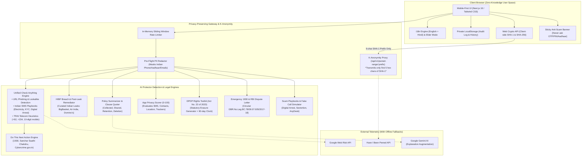

# AI Protector India 🛡️
### *HackerWrath 3.0 — Problem Statement 01: Digital Security and Trust*
**Module Focus: PRIVACY (Architected for plug-and-play integration with Fraud Prevention, Misinformation Detection, and Identity Protection)**

> **Product Mission:** One trusted, privacy-respecting platform for Indian citizens (students, senior citizens, and first-time internet users) to check links, messages, phone numbers, apps, and leaked data, understand why, and know exactly what to do next.

---

## 🎯 Core Value Proposition & Non-Negotiable Trust Standards
1. **Never Say "100% Safe":** Every verdict uses evidence-based, cautious wording (`Likely Safe`, `Possibly Suspicious`, `Likely Scam`). Safe outcomes always state: *"No known threat detected is not a guarantee of safety."*
2. **Zero Accounts & Zero Tracking:** No login required, no third-party trackers, no persistent server-side query storage. All logs are ephemeral; user history is stored 100% client-side in browser `localStorage`.
3. **Mandatory Anti-Scam Notice:** Prominently alerts all users: *"🔒 AI Protector will NEVER ask for your OTP, UPI PIN, Bank Password, Aadhaar or PAN card number."*
4. **"What Happens to Your Input" Guarantee:** Instant modal accessible across every tool explaining zero-persistence, in-memory processing, and DPDP alignment.
5. **Elder Mode & Multilingual Ready:** Built mobile-first with an Elder Mode (high-contrast large typography) and dual English + हिंदी (Hindi) translation.
6. **India-Specific "Do This Next" Action Engine:** Every scan result maps directly to India's national cyber defence infrastructure: **National Cybercrime Helpline 1930**, **DoT Sanchar Saathi Chakshu**, **cybercrime.gov.in**, and **RBI Banking Ombudsman**.

---

## 🏗️ 1-Page Mermaid Architecture Diagram



---

## 📂 Project Structure

```
ai-protector/
├── public/
│   ├── .well-known/
│   │   └── security.txt          # RFC 9116 compliant security disclosure
│   └── security.txt              # Standard security contact file
├── src/
│   ├── app/
│   │   ├── api/
│   │   │   ├── health/route.ts   # System diagnostics & memory telemetry
│   │   │   └── v1/
│   │   │       ├── check/route.ts                # Unified "Check Anything" API
│   │   │       ├── breach/route.ts               # Email breach API
│   │   │       ├── pwned-range/[prefix]/route.ts # K-Anonymity HIBP proxy
│   │   │       ├── policy/summarize/route.ts     # Privacy policy parser
│   │   │       ├── ai/copilot/route.ts           # Gemini AI Copilot
│   │   │       ├── files/hash/route.ts           # File checksum hashing
│   │   │       └── scans/urls/route.ts           # Link scanner
│   │   ├── layout.tsx            # Global layout with strict CSP & SEO tags
│   │   ├── page.tsx              # Main App Shell & Tab Controller
│   │   └── demo/page.tsx         # Moon Chat & visual component showcase
│   ├── components/
│   │   ├── india/
│   │   │   ├── CheckAnythingTab.tsx         # Feature 1 & 2: Check Anything + Do This Next
│   │   │   ├── BreachAndPasswordTab.tsx     # Feature 3 & 4: HIBP Breach + Client Password Hash
│   │   │   ├── PolicySummarizerTab.tsx      # Feature 5: Policy Summarizer & Clause Quoting
│   │   │   ├── AppPrivacyScoreTab.tsx       # Feature 6: App Privacy Score (0-100)
│   │   │   ├── DpdpToolkitTab.tsx           # Feature 7: DPDP Rights Toolkit & 90-Day Clock
│   │   │   ├── Emergency1930Tab.tsx         # Feature 8: Money-Lost Emergency & RBI Letter
│   │   │   ├── ScamPlaybooksTab.tsx         # Feature 9: Scam Playbooks & Call Simulator
│   │   │   ├── LocalPrivacyDashboardTab.tsx # Feature 10: Local Dashboard & Nuclear Purge
│   │   │   └── WhatHappensModal.tsx         # Privacy & Zero-Persistence Guarantee Modal
│   │   ├── layout/
│   │   │   └── AppShell.tsx                 # Navigation, sticky notice, language & elder toggle
│   │   └── ui/                              # ShinyButton, Toast, and interactive primitives
│   ├── lib/
│   │   ├── check/
│   │   │   └── check-anything-engine.ts     # Core multi-modal threat analysis engine
│   │   ├── privacy/
│   │   │   ├── k-anonymity-pwned.ts         # K-anonymity SHA-1 breach engine
│   │   │   ├── policy-analyzer.ts           # Policy clause extraction engine
│   │   │   ├── app-privacy-scorer.ts        # 0-100 rubric permission deduction engine
│   │   │   └── redactor.ts                  # PII & sensitive credential scrubbing
│   │   ├── india/
│   │   │   ├── dpdp-toolkit.ts              # DPDP Act 2023 legal letter generator
│   │   │   └── emergency-flow.ts            # RBI Zero-Liability dispute generator
│   │   ├── learn/
│   │   │   └── scam-playbooks.ts            # 5 Major Indian fraud playbooks & simulator
│   │   ├── i18n/
│   │   │   └── translations.ts              # English + Hindi translation dictionary
│   │   ├── security/
│   │   │   ├── rate-limiter.ts              # Sliding-window rate limiter
│   │   │   ├── url-inspector.ts             # Anti-SSRF and lookalike inspector
│   │   │   └── providers/webrisk-provider.ts# Google Web Risk adapter
│   │   └── observability/
│   │       └── url-safe-logger.ts           # Host + SHA256 hashed privacy logger
│   └── tests/
│       ├── hackathon-privacy.test.ts        # 16 Unit & integration tests for all 10 features
│       ├── security.test.ts                 # PII redaction and SSRF tests
│       ├── phase1-url-scanner.test.ts       # Link inspection tests
│       └── phase2-extension.test.ts         # MV3 extension tests
├── .env.example
├── package.json
└── README.md
```

---

## ⚡ Setup & Installation

### Prerequisites
- **Node.js**: v20+ or v22+
- **Package Manager**: `npm`

### 1. Install Dependencies
```bash
npm install
```

### 2. Configure Environment (Optional)
```bash
cp .env.example .env.local
```
*(All 10 features operate seamlessly in offline/fallback mode even with an empty `.env.local`)*

### 3. Run Automated Tests
```bash
# Run all 73 test suites across the application
npm test

# Or run specifically the HackerWrath 3.0 privacy suite:
npm run test:privacy
```

### 4. Start Development Server
```bash
npm run dev
```
Open **[http://localhost:3000](http://localhost:3000)** in your browser.

---

## 🎬 Hackathon Demonstration Script (5-Minute Winning Pitch)

### Step 1: The Trust Foundation & Anti-Scam Banner
1. Open `http://localhost:3000`.
2. Point out the sticky amber top banner: *"🔒 AI Protector will NEVER ask for your OTP, UPI PIN, Bank Password, Aadhaar or PAN card number."*
3. Toggle between **English** and **हिंदी (Hindi)** in the top bar to show localized Indian experience.
4. Toggle **Elder Mode (👓)** to demonstrate large-text accessibility for senior citizens.
5. Click **"🛡️ What happens to your input?"** to show the zero-storage, local-first promise.

### Step 2: "Check Anything" Box (Features 1 & 2)
1. Paste the Electricity Disconnection Scam SMS:
   ```text
   Dear Consumer, your electricity power will be disconnected tonight at 9:30 PM from power station because your previous month bill was not updated. Please call electric officer at 9876543210 immediately.
   ```
2. Click **Check**.
3. **Verdict:** `Likely Scam / Phishing` with a 98% confidence score.
4. **Red Flags:** Highlights urgency manipulation and unauthorized personal mobile numbers.
5. **Do This Next Panel:** Immediate actions to report on **Chakshu (Sanchar Saathi)**, never call back, and dial **1930** if money was lost.

### Step 3: K-Anonymity Breach & Password Checker (Features 3 & 4)
1. Navigate to **Breach & Password**.
2. Enter email `test@example.com` -> shows historical breaches (**BigBasket India** and **Air India SITA**) with an actionable post-leak remediation checklist (biometric mAadhaar lock, 2FA, password change).
3. Test a compromised password (e.g., `password` or `123456`).
4. **Inspect Network Tab:** Prove to judges that the full password NEVER leaves the browser; only the 5-character SHA-1 prefix (`5BAA6` or `7C4A8`) is transmitted.

### Step 4: Privacy Policy Summarizer (Feature 5)
1. Navigate to **Policy Summarizer**.
2. Click **Load Sample Privacy Policy** or paste any policy text.
3. Shows 4 categorized sections:
   - **Data Collected** (Location, Contacts, Browsing)
   - **Shared With** (Third-party ad networks, trackers)
   - **Retention Schedule** (Lifespan and backup timelines)
   - **How to Delete** (Erasure and closure procedures)
4. Every point quotes the exact clause from the policy text and displays the required disclaimer: *"⚠️ AI and automated text extraction can make mistakes. Always verify the quoted clause."*

### Step 5: App Privacy Score (Feature 6)
1. Navigate to **App Privacy Score**.
2. Click **"Predatory Instant Loan App"** preset.
3. Score plunges to **18/100 (Hazardous)** due to dangerous `READ_SMS`, `READ_CONTACTS`, `LOCATION`, and embedded advertising trackers.
4. Click **"Privacy-First Calculator"** preset -> jumps to **100/100 (Exceptional)**.

### Step 6: DPDP Rights Toolkit (Feature 7)
1. Navigate to **DPDP Rights Toolkit**.
2. Select **Data Erasure Notice (Section 12(3))**.
3. Enter company: `Swiggy` and your name.
4. Instantly generates a formal legal notice citing the **Digital Personal Data Protection Act, 2023**.
5. Shows the **90-Day Grievance Countdown Tracker** and the escalation ladder to the **Data Protection Board of India (DPBI)**.
6. Highlights the statutory notice: *"Detailed subordinate rules phase in progressively towards 13 May 2027. Verify against official Gazette text."*

### Step 7: Money-Lost Emergency Mode (Feature 8)
1. Navigate to **1930 Emergency**.
2. Emphasizes the **Golden Hour (first 2 hours)** for freezing bank accounts before withdrawal.
3. Fill victim name, bank, and transaction UTR.
4. Generates an automated **Bank Dispute Letter** under **RBI Circular DBR.No.Leg.BC.78/09.07.005/2017-18** claiming Zero Customer Liability within the 3-day reporting window.

### Step 8: Scam Playbooks & Interactive Call Simulator (Feature 9)
1. Navigate to **Scam Playbooks**.
2. Review the top 5 playbooks: **Digital Arrest**, **Electricity Bill**, **Telegram Part-Time Jobs**, **Sextortion**, and **AnyDesk Remote Access**.
3. Launch the **"Practise a Fake Scam Call" Simulator**:
   - The fake "CBI Inspector" threatens arrest over drugs found in a DHL parcel.
   - Choose to negotiate -> simulator flags the psychological fear trap.
   - Choose the correct protocol: *"Indian police never conduct arrests over video call. Disconnecting and dialing 1930."* -> Safe response verified!

### Step 9: Local Privacy Dashboard (Feature 10)
1. Navigate to **Privacy Dashboard**.
2. Displays recent scans and flagged hazards stored strictly in browser `localStorage`.
3. Click **"Export Audit Log (JSON)"** to download your records.
4. Click **"Nuclear Purge (Wipe All Data)"** -> browser memory is completely cleared.

---

## 🧪 Sample Test Inputs for Judges & Reviewers

| Test Category | Sample Input | Expected Verdict / Behavior |
|---|---|---|
| **Electricity Scam SMS** | `Dear Consumer, your electricity power will be disconnected tonight at 9:30 PM from power station because your previous month bill was not updated. Please call electric officer at 9876543210.` | `Likely Scam` (Urgency pressure, personal mobile number, 1930 & Chakshu actions) |
| **Digital Arrest Message** | `This is DCP Crime Branch Mumbai. A parcel containing narcotics and illegal passports in your Aadhaar name has been intercepted. You are placed under digital arrest on Skype video call.` | `Likely Scam` (Digital arrest impersonation flag, Supreme Court disclaimer) |
| **SBI KYC Phishing Link** | `http://sbi-yono-kyc-verify.net/pan-update.php` | `Likely Scam` (Insecure HTTP, Brand impersonation lookalike, Cybercrime.gov.in link) |
| **Foreign Threat Call** | `+92 300 1234567` | `Likely Scam` (+92 international origin, DoT Chakshu reporting step) |
| **Clean Government URL** | `https://www.incometax.gov.in/iec/foportal/` | `Likely Safe` (Disclaims "No known threat is not a guarantee of safety") |
| **Breached Email** | `test@example.com` or `user@bigbasket.com` | `Breached: Yes` (2 Leaks: BigBasket & Air India SITA; remediation checklist) |
| **Clean Email** | `uncompromised.citizen.2026@securemail.gov.in` | `Breached: No` (0 leaks; proactive hygiene advice) |
| **Weak / Breached Password** | `password` | 3,861,493 pwned occurrences (Transmits only prefix `5BAA6`) |
| **Common Number Password** | `123456` | 23,514,210 pwned occurrences (Transmits only prefix `7C4A8`) |

---

## ⚖️ Known Limitations & Statutory Nuances
1. **Zero-Day Phishing Domains:** Newly registered phishing websites created minutes prior may not be listed in global threat feeds. AI Protector mitigates this using multi-signal heuristics (HTTP flags, brand keywords, generic TLDs).
2. **Phone Number Spoofing:** Criminals using illegal VoIP gateways can spoof caller IDs to display legitimate police station numbers. Our advice always insists on physical station verification.
3. **DPDP Act 2023 Implementation Timeline:** The DPDP Act has received Presidential Assent; however, subordinate procedural rules, grievance mechanisms, and DPBI inquiry guidelines phase in progressively towards **13 May 2027**. The toolkit clearly informs users to verify against official Gazette texts.
4. **AI Output Fallibility:** AI models can misinterpret nuance. In accordance with Master Build Rules, AI explanations never raise or lower risk status by themselves, and clause extracts disclaim that AI can make errors.
5. **Never Say "100% Safe":** Security threats evolve continuously. AI Protector never gives false security guarantees.

---

## 🔒 Security & Privacy Policy (RFC 9116)
- **RFC 9116 Security Disclosure:** Available at `/.well-known/security.txt` and `/security.txt`.
- **Content Security Policy (CSP):** Strict script, frame, and connect-src policies restricting unvetted origins.
- **Data Minimization:** No raw passwords, banking credentials, or personal messages are ever persisted to server logs.
- **Emergency Escalation:** National Cybercrime Helpline **1930** and Sanchar Saathi **Chakshu** integration.
